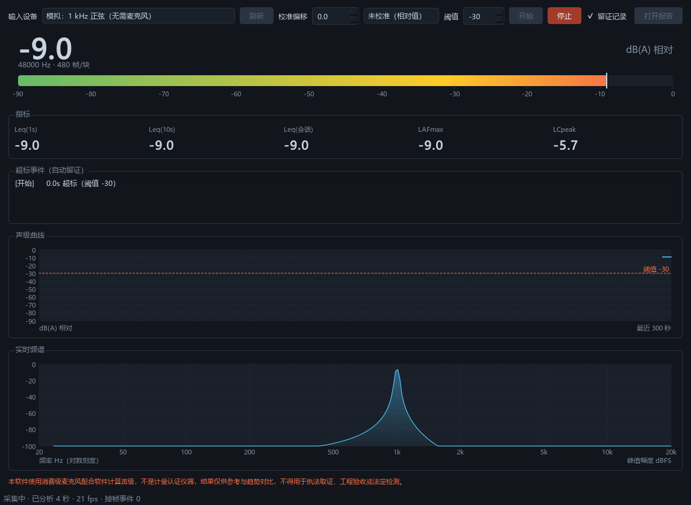

# NoiseKit

[](https://github.com/ahooop/noisekit/actions/workflows/ci.yml)
[](https://github.com/ahooop/noisekit/releases/latest)
[](LICENSE)

简体中文 | [English](#english)

> **用途声明**：NoiseKit 使用消费级麦克风配合软件计算声级，**不是计量认证仪器**（不符合 IEC 61672 / GB/T 3785 对 1 级或 2 级声级计的要求）。结果仅供个人参考、趋势对比与过程记录，**不得用于执法取证、工程验收或法定检测**。未经校准的读数一律标注为 dBFS 相对值。

插上麦克风就能连续测环境噪声：实时看分贝曲线与频谱，超过阈值自动留证（前置缓冲录音 + 时间 + 峰值），一键导出可分享的报告。



> 状态：**v0.1.1**。Windows 免安装包见 [Releases](../../releases)，Python 包在 PyPI 的发行名是 `noisekit-spl`（`noisekit` 已被一个无关项目占用，import 名仍是 `audio_core`）。设计规格见 [docs/superpowers/specs](docs/superpowers/specs/)，实现计划见 [docs/superpowers/plans](docs/superpowers/plans/)。

<a id="english"></a>

## English

**NoiseKit** turns any consumer microphone into a continuous environmental-noise monitor that keeps *evidence*, not just numbers. Built for Windows; Python 3.11+, MIT.

Plug in a mic and you get real-time dB(A)/Leq, a 2048-point FFT spectrum and a scrolling level curve. When the level stays above your threshold for a configurable duration, NoiseKit records the event: **5 seconds of pre-trigger audio**, a row in SQLite, and an HTML report with the curve, the event table and a disclaimer — one file, no external assets, double-click to open.

Why the pre-buffer matters: if you only start recording after the threshold trips, the loudest part is already gone and playback holds just the tail of the noise. So the recorder always keeps the last 5 seconds rolling and writes them out at trigger time.

- **Metrics** — instantaneous dB, A/C weighting, Fast/Slow/Impulse time weighting, Leq (1 s / 10 s / session), LAFmax, LCpeak
- **Evidence** — 16-bit WAV with 5 s pre-buffer, metric frames at 10 Hz in SQLite (WAL), single-file HTML report + CSV export
- **Alerts** — threshold + minimum duration + cooldown, so one continuous noise produces exactly one event
- **Calibration** — manual offset or a wizard (enter a reference SPL, sample 2 s, the offset is computed and remembered per device)
- **Packaging** — PyInstaller portable build for Windows, no Python required; a frozen-build smoke test runs on every CI build

### Library use

`audio_core` is the analysis engine and depends on numpy + scipy only — **no Qt, no network**, so other Python projects can measure noise instead of re-deriving IEC 61672 math:

```bash
pip install noisekit-spl        # distribution name on PyPI
python -m audio_core.cli --source device
noisekit --doctor               # same entry point, both script names work
```

The import package (`audio_core`) and the command (`noisekit`) keep their names; only the PyPI distribution is `noisekit-spl`, because `noisekit` was already taken there by an unrelated project.

### Status

99 tests, CI matrix over Linux/macOS/Windows × Python 3.11/3.12, `ruff` and an architecture check that keeps `audio_core` free of GUI imports. Windows portable build and per-version changelog in [Releases](../../releases).

> **Not a certified sound level meter.** A consumer mic plus software math does not meet IEC 61672 (or GB/T 3785) class 1/2. Readings are for personal reference, trend comparison and record-keeping — not for enforcement, acceptance testing or legal metrology. Uncalibrated readings are labelled as relative dBFS.

## 四种用法

```bash
python -m apps.desktop.main                       # 桌面界面（推荐，默认自动留证）
python -m apps.desktop.main --synthetic           # 没有麦克风时用模拟信号看界面
python -m audio_core.cli --source device          # 终端里实时刷新
python -m audio_core.cli --source device --session-dir ./今晚   # 留证：录音 + 数据库 + 报告
python -m audio_core.cli --doctor                 # 排障
python -m audio_core.cli --calibrate 94.0         # 用参考声压级校准
```

## 留证到底留了什么

一次会话会在目录里生成三样东西：

```
sessions/20261022-233000/
├── session.db     指标帧（10 Hz）+ 事件表，SQLite
├── audio/         超标时段的 WAV，含触发前 5 秒
└── report.html    一页报告：曲线 + 事件表 + 免责声明
```

前置缓冲是关键：等超过阈值才开始录，录到的第一秒往往已经被削掉，
回放只剩「响声的尾巴」。所以录音器始终滚动保存最近 5 秒音频，
事件触发的瞬间把这段一起写进文件。

## 解决什么问题

| 场景 | NoiseKit 给出的东西 |
| --- | --- |
| 楼上深夜装修，需要留证据 | 连续声级曲线 + 超标时段的录音 + 一页 HTML 报告 |
| 机房 / 工地 / 宿舍需要长期值守 | 24 小时不中断采集，事后回看「几点最吵、峰值多少」 |
| 搬家租房前想测环境底噪 | 打开即测，实时 dB(A) 与 Leq |

## 能力

- 实时指标：瞬时 dB、A/C 计权、Fast/Slow 时间计权、Leq(1s/10s/会话)、LAFmax、LCpeak
- 实时可视化：dB 时间序列曲线、2048 点频谱（对数频率轴）
- 阈值告警：阈值 + 持续时长 + 冷却，持续的噪音只算**一次**事件
- 留证录音：**5 秒前置缓冲** + 事件全程 + 5 秒后置，16-bit WAV
- 数据落盘：SQLite（WAL）批量写，崩溃后已有数据仍可读、可导出
- 导出：CSV 指标表 + **单文件** HTML 报告（内联 SVG，零外部依赖，双击即看）
- 手动校准 + **校准向导**：填参考声压级、采 2 秒、自动算偏移；配置随设备一起记住

不在 v0.1 范围：音乐分析、语音转写、设备频响测试、云同步、移动端。

## 架构

```
audio_core/     纯 Python 分析引擎，零 Qt 依赖，可 pip 安装复用
  capture/      设备枚举、实时流、环形缓冲、可替换音频源
  dsp/          分帧、FFT、A/C 计权、时间计权、dB 换算与校准
  metrics/      块 → FrameMetrics
  analyzers/    插件协议 + noise 实现（music/voice/device 预留）
  events/       告警状态机 + 留证录音
  storage/      SQLite 读写
apps/desktop/   PySide6 桌面界面
```

采集回调只做内存拷贝，DSP 在工作线程完成，UI 按 30 fps 限速刷新且**不追帧**——这是能连跑 24 小时的前提。

## 开发

```bash
git clone <repo-url> && cd noisekit
python -m venv .venv && .venv\Scripts\activate   # Windows
pip install -e ".[dev]"
pytest
python -m audio_core.cli                          # 终端里看实时 dB
python -m apps.desktop.main                       # 图形界面
```

要求 Python ≥ 3.11。音频后端依赖 PortAudio（`sounddevice` 会自动带上）。

只想把分析引擎当库用，不装界面依赖：`pip install noisekit-spl`（发行名，import 名仍是 `audio_core`）。

## 打包成可双击的程序

```bash
pip install pyinstaller
python scripts/build.py          # 产物在 dist/NoiseKit/
```

整个 `dist/NoiseKit/` 目录拷到没装 Python 的机器上，双击 `NoiseKit.exe` 就能用。

打包有两个必踩的坑，脚本里都处理了：

- `sounddevice` 在**运行时**才去 `_sounddevice_data` 里加载 PortAudio DLL，PyInstaller 的静态分析看不见这一步。漏了的表现是「程序能启动，但一个设备都找不到」，所以必须 `--add-data` 显式带上。
- `--windowed` 打包后 `sys.stdout` 是 `None`，一句 `print` 就能让程序崩掉，入口里做了兜底。

验证方式：

```bash
dist/NoiseKit/NoiseKit.exe --selftest-cli   # 不开窗口，验证冻结的依赖与 PortAudio
dist/NoiseKit/NoiseKit.exe --selftest       # 开窗口采 2 秒，验证界面链路
```

`--selftest-cli` 在 CI 里每次提交都跑；界面链路由 `tests/test_gui.py` 在三平台上用源码覆盖。
两条加起来，打包风险（漏 DLL、漏 hidden import）和界面风险都被盯住了。

## 参与

见 [CONTRIBUTING.md](CONTRIBUTING.md) 与 [CODE_OF_CONDUCT.md](CODE_OF_CONDUCT.md)。

Bug 与功能建议请走 Issue 模板：报 Bug 会要求填系统、麦克风型号与 `noisekit --doctor` 输出，
提功能请先说清「你遇到的具体麻烦」。不接受弱化免责声明、或为凑功能数量而加的 PR。

发布流程（改版本号 → 推标签 → 自动出 Windows 包与 PyPI 包）见 [docs/releasing.md](docs/releasing.md)。

## 许可证

[MIT](LICENSE)
